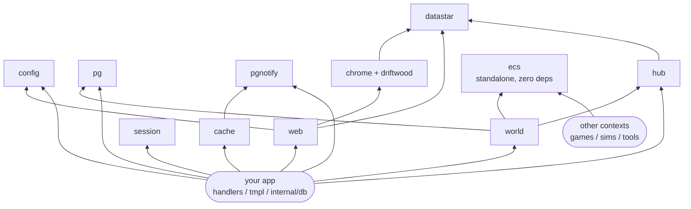

# the-beach — documentation index

A reusable, hypermedia-first, SSR web framework for Go. Extracted from manifold13.tv,
hardened, and extended with a custom entity component system for realtime app state.
Stack: Echo · templ · Datastar · Tailwind · pgx · sqlc · goose · Postgres
LISTEN/NOTIFY · SSE · Valkey · custom `ecs` engine.

**Status:** pre-implementation. The RFC and architecture docs below are the current
deliverables; project 1 (`config` + `pg` + `pgnotify`) is the first code.

## The realtime spine

How a beach app hangs together — handlers, the ECS world, the hub, and Postgres:

## Package dependencies

Arrows point at what a package imports. The boot spine and `session` stand alone;
`ecs` imports nothing and is importable by anything, the-beach or not:

## RFC — the why and the what

| Doc                                          | Covers                                                                |
| -------------------------------------------- | --------------------------------------------------------------------- |
| [1 — Charter](rfc/01-charter.md)             | Problem, goal, non-goals, philosophy                                  |
| [2 — Extraction](rfc/02-extraction.md)       | What gets lifted from manifold13.tv, what warts get fixed             |
| [3 — The ECS pitch](rfc/03-ecs.md)           | Why a custom engine, the design pillars, the hybrid boundary          |
| [4 — Program & risks](rfc/04-program.md)     | The 8 shippable projects, validation criteria, risks                  |

## Architecture — the how

| Doc                                                       | Covers                                                              |
| --------------------------------------------------------- | -------------------------------------------------------------------- |
| [1 — Layout](architecture/01-layout.md)                   | Stack contract, module layout, consuming-app shape                  |
| [2 — Boot spine](architecture/02-boot-spine.md)           | `config`, `pg` (advisory-lock migrate, InTx), `pgnotify`            |
| [3 — HTTP layer](architecture/03-http.md)                 | App builder, `PageFunc`/`ActionFunc`/`StreamFunc`, guards, datastar |
| [4 — Hub](architecture/04-hub.md)                         | Topic fan-out, render-once-per-topic, tickers                       |
| [5 — Cache & session](architecture/05-services.md)        | Snapshot/keyed caches, NOTIFY invalidation, Valkey sessions         |
| [6 — Chrome](architecture/06-chrome.md)                   | Component interface, semantic tokens, the no-pop-in law             |
| [7 — ECS engine](architecture/07-ecs.md)                  | The custom standalone engine: schema, storage, change ticks         |
| [8 — World](architecture/08-world.md)                     | The boundary, tick loop, dirty→fragments, persistence lanes         |
| [9 — Lifecycles](architecture/09-lifecycles.md)           | Page / action / stream / external write, end to end                 |
| [10 — Tooling & testing](architecture/10-tooling.md)      | `beach new` / `beach vet` / `beach ecs gen`, test doctrine          |
| [11 — Decisions log](architecture/11-decisions.md)        | Every load-bearing choice and why                                   |

## Reading paths

- **Auditing the plan?** RFC 1 → 2 → 3 → 4, then the decisions log.
- **Auditing the ECS?** RFC 3 → Architecture 7 → 8 → 9.
- **Building project 1?** Architecture 1 → 2, RFC 4 for scope.
