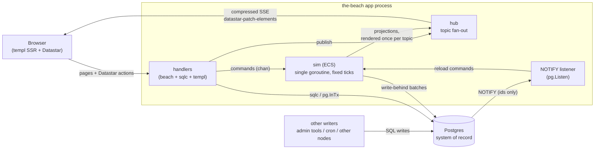
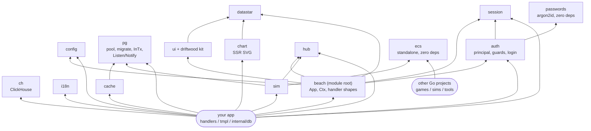

# the-beach — documentation index

A reusable, hypermedia-first, SSR web framework for Go, with a custom entity
component system for realtime app state.
Stack: Echo · templ · Datastar · Stellar · pgx · sqlc · goose · Postgres
LISTEN/NOTIFY · SSE · custom `ecs` engine. The module root is the framework's
front door: `import beach "github.com/ThirdCoastInteractive/the-beach"`.

**Status:** implementation started. `config` has landed (tested); the parallel
execution plan is [ROADMAP.md](ROADMAP.md). The RFC and architecture docs below are the
design of record.

## The realtime spine

How a beach app hangs together — handlers, the sim, the hub, and Postgres:

## Package dependencies

Arrows point at what a package imports. The boot spine stands alone; `ecs` imports
nothing and is importable by anything, the-beach or not; the root `beach` package is
what an app touches first:

## RFC — the why and the what

| Doc                                      | Covers                                                       |
| ---------------------------------------- | ------------------------------------------------------------ |
| [1 — Charter](rfc/01-charter.md)         | Problem, goal, non-goals, philosophy                         |
| [2 — Scope](rfc/02-scope.md)             | Every package and its responsibility; the framework laws     |
| [3 — The ECS pitch](rfc/03-ecs.md)       | Why a custom engine, the design pillars, the hybrid boundary |
| [4 — Program & risks](rfc/04-program.md) | The 10 shippable projects, validation criteria, risks        |

## Architecture — the how

| Doc                                                     | Covers                                                                                   |
| ------------------------------------------------------- | ---------------------------------------------------------------------------------------- |
| [1 — Layout](architecture/01-layout.md)                 | Stack contract, module layout per go.dev/doc/modules/layout                              |
| [2 — Boot spine](architecture/02-boot-spine.md)         | `config`, `pg` (pool, advisory-lock migrate, InTx, Listen/Notify)                        |
| [3 — HTTP layer](architecture/03-http.md)               | Root `beach` package: App builder, handler shapes, guards, SSE gzip                      |
| [4 — Hub](architecture/04-hub.md)                       | Topic fan-out, render-once-per-topic, tickers                                            |
| [5 — Cache, session, i18n](architecture/05-services.md) | Snapshot/keyed caches, NOTIFY invalidation, Postgres sessions, i18n                      |
| [6 — UI toolkit](architecture/06-ui.md)                 | Kits, tokens, no pop-in, no blocking, the 14KB rule, deferred sections                   |
| [7 — ECS engine](architecture/07-ecs.md)                | The custom standalone engine: schema, Store, change ticks                                |
| [8 — Sim](architecture/08-sim.md)                       | The boundary, tick loop, projections, persistence lanes                                  |
| [9 — Lifecycles](architecture/09-lifecycles.md)         | Page / action / stream / external write, end to end                                      |
| [10 — Tooling & testing](architecture/10-tooling.md)    | `beach new` / `beach vet` / `beach ecs gen` / `beach i18n`, test doctrine                |
| [11 — Decisions log](architecture/11-decisions.md)      | Every load-bearing choice and why                                                        |
| [12 — Auth](architecture/12-auth.md)                    | argon2id passwords, login flow, principal/RBAC, guards                                   |
| [13 — API codegen](architecture/13-apigen.md)           | `beach-apigen`: six SQL annotations → routes, handlers, NOTIFY (hypermedia-only)         |
| [14 — Analytics](architecture/14-analytics.md)          | `chart` (SSR SVG, 18 types) + `ch` (ClickHouse client, batcher, migrations)              |
| [15 — Example apps](architecture/15-examples.md)        | boardwalk (Monopoly/sim), driftbottle (stranger chat/hub), pantry (ERP/apigen+analytics) |
| [16 — Component catalog](architecture/16-components.md) | The concrete component/layout inventory by Kit sub-interface, and the specimen page      |

## Reading paths

- **Auditing the plan?** RFC 1 → 2 → 3 → 4, then the decisions log.
- **Auditing the ECS?** RFC 3 → Architecture 7 → 8 → 9.
- **Auditing the frontend story?** Architecture 3 → 6 → 16 → 9.
- **Auditing auth & codegen?** Architecture 12 → 13 → 10.
- **Building project 1?** Architecture 1 → 2, RFC 4 for scope.
