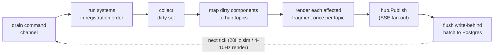

# Architecture 8 — The world: web integration over `ecs`

[← docs index](../README.md) · prev: [ECS engine](07-ecs.md) · next: [Lifecycles](09-lifecycles.md)

## The boundary

Read this before adding a component.

The world hosts the **live slice**: currently-connected users, the active show, and
their hot components — anything mutated every tick or every few seconds and read by
fan-out rendering (presence, XP accrual, buffs, cooldowns, drop timers, equipped
items, live show state). Entities load on connect/show-start and evict on
disconnect/show-end.

The world never hosts: auth, sessions, account CRUD, payments, trade settlement,
calendars, or anything whose primary access pattern is an ad-hoc relational query.
Postgres's ACID and SQL are the feature there — the database already is an ECS for
cold data. **Money, items, and trades commit to Postgres in a synchronous transaction
first; the world reflects the committed result.** XP, presence, and ephemera flow the
other way: world first, write-behind to Postgres.

## Single-writer loop

```go
w := world.New(world.Config{TickRate: 20, RenderRate: 8})
w.AddSystem(xp.System{}, presence.System{}, drops.System{})   // fixed order
w.OnDirty(topicMapper)                                        // dirty set → hub topics
go w.Run(ctx)

// Handlers never touch the world directly:
w.Send(cmd.AwardXP{User: uid, Amount: 50})                    // fire-and-forget
reply, err := world.Ask[cmd.CraftResult](ctx, w, cmd.Craft{...}) // request/reply
```

One goroutine owns the world. Commands arrive on a channel and are drained at the top
of each tick; systems run in registration order; no locks anywhere. Determinism makes
tests trivial: construct world, send commands, tick N times, assert.

Tick pipeline:



Sim rate and render fan-out rate are decoupled (20Hz sim / 4–10Hz render is plenty
for a website — the Unity Netcode snapshot-rate pattern).

## Change detection → fragments

Change detection is [native to `ecs`](07-ecs.md#the-portable-core-model): mutation
through the generated accessors stamps the component column with the current tick,
and `world` collects the tick's dirty set with `ecs.Changed[T]` queries — no
observers, no manual dirty flags. The app registers the mapping from dirty components
to hub topics + templ fragments:

```go
world.Render(w, world.Fragment[comp.XP]{
    Topic:    func(e world.Entity, xp comp.XP) string { return "user:" + owner(e) },
    Selector: "xp-bar",
    Templ:    func(e world.Entity, xp comp.XP) templ.Component { return ui.XPBar(xp) },
})
```

After each render tick, every dirty (entity, component) renders its fragment once and
publishes the patch to its topic; the hub writes it to every subscribed SSE
connection as a `datastar-patch-elements` event. "Only send what changed to who can
see it" is interest management, and it falls out of the dirty set — nothing diffs the
DOM, nothing polls.

## Persistence

Three lanes, chosen per component:

| Lane           | For                                    | Mechanism                                                                                                                                                 |
| -------------- | -------------------------------------- | --------------------------------------------------------------------------------------------------------------------------------------------------------- |
| Synchronous tx | money, items, trades, anything audited | handler does `pg.InTx` first, then `w.Send(ApplyCommitted{...})`                                                                                          |
| Write-behind   | XP, presence, stats                    | dirty components batched and upserted to component-mirror tables each flush tick (sqlc queries, mechanical mapping: component = table keyed by entity id) |
| Snapshot       | pure ephemera (cooldowns, buffs)       | versioned CBOR `ecs` snapshot on shutdown / interval; restore is best-effort                                                                              |

Component-mirror tables keep the data legible to plain SQL, admin tooling, and
analytics — no opaque world blob as system of record. The token ledger is an
append-only journal table regardless of lane.

## Other writers

Admin tools, cron, and other processes mutate Postgres directly. Triggers NOTIFY with
ids; a `pgnotify` listener in the app turns those into world commands
(`w.Send(cmd.ReloadEntity{Table: "items", ID: id})`). That's the whole multi-writer
story in v1 — and the seam (`pgnotify` → commands, `hub` → fan-out) is exactly where
NATS would replace Postgres NOTIFY if the app ever spans nodes.
